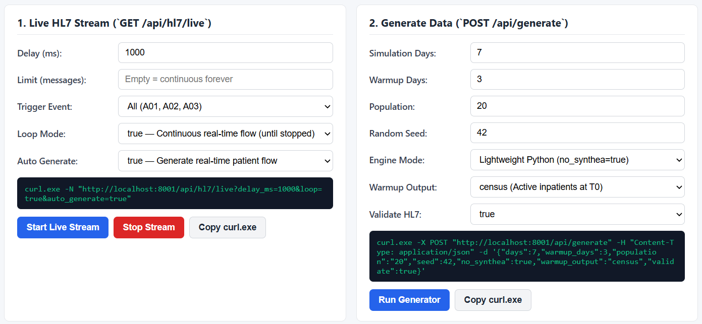

# PatientFlow

**PatientFlow** is a hospital capacity and patient-flow intelligence platform designed around the Portuguese NHS (SNS / ULS) organizational hierarchy (`ULS → Unit → Building → Floor → Service → Wing → Ward → Room → Bed`). It combines real-time bed management, HL7/FHIR ingestion, audit logging, discharge prediction, and constraint-based bed allocation suggestions.

---

## Repository Structure

| Directory | Description | Documentation |
|---|---|---|
| `patient-flow-intelligence/frontend/` | React + TypeScript + Vite + Tailwind web application | [Frontend README](patient-flow-intelligence/frontend/README.md) |
| `patient-flow-intelligence/backend/` | Spring Boot 4 (Java 21) REST API, Flyway migrations, Keycloak & Redis | [Backend README](patient-flow-intelligence/backend/README.md) |
| `patient-flow-intelligence/algorithms/` | FastAPI service for bed ranking, occupancy forecast, and discharge prediction | [Algorithms README](patient-flow-intelligence/algorithms/README.md) |
| `patient-flow-intelligence/bed-allocation-service/` | Python CP-SAT solver for bed allocation suggestions | [Bed Allocation README](patient-flow-intelligence/bed-allocation-service/README.md) |
| `patient-flow-intelligence/keycloak/` | Preconfigured `patientflow` realm and custom login theme | — |
| `tools/data-generation/` | Synthetic hospital patient & ADT event generator | [Data Generation README](tools/data-generation/README.md) |
| `tools/hl7-fhir-converter/` | HL7 v2 ADT to FHIR R4 Bundle converter | [HL7-FHIR Converter README](tools/hl7-fhir-converter/README.md) |
| `mock-hierarchy/` | Example `.csv` and `.xlsx` files for admin hierarchy import/export | [mock-hierarchy/](mock-hierarchy/) |

---

## Quick Start (Try It Locally)

### Prerequisites
- **Docker** & **Docker Compose**
- **OpenSSL** (Linux/macOS/Git Bash) or **Python 3** with `cryptography` (Windows PowerShell) to generate the local HTTPS certificate for Keycloak.

### 1. Configure Environment
```bash
cd patient-flow-intelligence
cp .env.example .env
```

### 2. Generate Local HTTPS Certificates for Keycloak
Keycloak expects `localhostCertificate.pem` and `localhostKey.pem` inside `patient-flow-intelligence/certs/`.

**Linux / macOS / Git Bash:**
```bash
mkdir -p certs && cd certs
openssl req -x509 -out localhostCertificate.pem -keyout localhostKey.pem -newkey rsa:2048 -nodes -sha256 \
  -subj '/CN=localhost' \
  -extensions EXT -config <(printf "[dn]\nCN=localhost\n[req]\ndistinguished_name=dn\n[EXT]\nsubjectAltName=DNS:localhost,DNS:keycloak\nkeyUsage=digitalSignature,keyEncipherment\nextendedKeyUsage=serverAuth")
cd ..
```

**Windows (PowerShell):**
```powershell
python -c "import os, datetime, ipaddress; from cryptography import x509; from cryptography.x509.oid import NameOID, ExtendedKeyUsageOID; from cryptography.hazmat.primitives import hashes, serialization; from cryptography.hazmat.primitives.asymmetric import rsa; os.makedirs('certs', exist_ok=True); k = rsa.generate_private_key(65537, 2048); s = x509.Name([x509.NameAttribute(NameOID.COMMON_NAME, 'localhost')]); c = x509.CertificateBuilder().subject_name(s).issuer_name(s).public_key(k.public_key()).serial_number(x509.random_serial_number()).not_valid_before(datetime.datetime.now(datetime.timezone.utc)).not_valid_after(datetime.datetime.now(datetime.timezone.utc) + datetime.timedelta(days=825)).add_extension(x509.SubjectAlternativeName([x509.DNSName('localhost'), x509.DNSName('keycloak'), x509.IPAddress(ipaddress.IPv4Address('127.0.0.1'))]), critical=False).add_extension(x509.KeyUsage(True, False, True, False, False, False, False, False, False), critical=False).add_extension(x509.ExtendedKeyUsage([ExtendedKeyUsageOID.SERVER_AUTH]), critical=False).sign(k, hashes.SHA256()); open('certs/localhostKey.pem', 'wb').write(k.private_bytes(serialization.Encoding.PEM, serialization.PrivateFormat.TraditionalOpenSSL, serialization.NoEncryption())); open('certs/localhostCertificate.pem', 'wb').write(c.public_bytes(serialization.Encoding.PEM)); print('Certificates created in certs/!')"
```

### 3. Start the Stack
From inside `patient-flow-intelligence/`:
```bash
docker compose up -d --build
```

### 4. Access the Services

| Service | URL |
|---|---|
| **Frontend** | http://localhost:5173 |
| **Backend API / Swagger UI** | http://localhost:8080/swagger-ui.html |
| **Keycloak Admin** | https://localhost:9080 (`admin` / `admin`) |
| **Algorithms Service** | http://localhost:8001/health |
| **Bed Allocation Service** | http://localhost:8002/api/v1/health |
| **RabbitMQ Management** | http://localhost:15672 (`pfi` / `pfi`) |
| **Data Generation** | http://localhost:8001/ui

---

## Simulating Hospital Data Flow

To populate the platform with realistic synthetic patients and live ADT events (admissions, transfers, and discharges as FHIR R4 Bundles), open the Data Generation UI at http://localhost:8001/ui:



1. **Populate the hospital hierarchy:** Click **Run Generator** on the right side to seed the database with the hospital structure.
2. **Simulate live patient flow:** Click **Start Live Stream** to begin generating events. Live generated data will appear at the bottom of the UI.

For installation, SSE/Webhook streaming, and hospital topology configuration, see the [Data Generation README](tools/data-generation/README.md).

---

## Admin Hierarchy Import / Export

The [`mock-hierarchy/`](mock-hierarchy/) directory contains example hierarchy files ([`mock-hierarchy.csv`](mock-hierarchy/mock-hierarchy.csv) and [`mock-hierarchy.xlsx`](mock-hierarchy/mock-hierarchy.xlsx)) showing the expected column structure (`uls`, `unit`, `building`, `floor`, `service`, `serviceCode`, `wing`, `ward`, `wardCode`, `room`, `bed`). Follow these examples as a template when using the **Import / Export** functionality in the admin hierarchy view.

---

## Detailed Documentation

- **Backend Architecture & Config:** [backend/README.md](patient-flow-intelligence/backend/README.md)
- **Operational & FHIR Contracts:** [backend/OPERATIONS.md](patient-flow-intelligence/backend/OPERATIONS.md)
- **Security, Roles & WebSocket Events:** [backend/SECURITY.md](patient-flow-intelligence/backend/SECURITY.md)
- **Analytics & Algorithms Integration:** [backend/ANALYTICS.md](patient-flow-intelligence/backend/ANALYTICS.md)
- **Redis Caching:** [backend/REDIS-CACHE.md](patient-flow-intelligence/backend/REDIS-CACHE.md)
- **Changelog:** [CHANGELOG.md](CHANGELOG.md)
